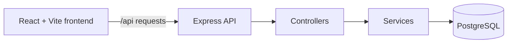

<p align="center">
  
</p>

<p align="center">
  <a href="https://finsight.bytexl.live/"></a>
  
</p>

<p align="center">
  
  
  
  
  
  
</p>

**FinSight** is a full-stack personal finance dashboard. It brings your accounts, transactions, budgets, savings goals, debts and recurring payments into one place, with analytics charts and an audit trail, all backed by a live PostgreSQL database.

🔗 **Live website:** [finsight.bytexl.live](https://finsight.bytexl.live/)

> ⚠️ **Project status: work in progress.**
> FinSight is **not completely finished yet**. Some pages and features are still being built or polished, and we will keep improving it. Expect rough edges while we complete the remaining parts.

---

## 🖼 Screenshots

### Dashboard: Financial Command Center


### Transactions


### Budgets


### Analytics


---

## ✨ Features

| Area | What you can do |
| --- | --- |
| 📊 **Dashboard** | Net worth, recent income and spending, financial score, savings rate and debt ratio at a glance |
| 💳 **Accounts** | Track bank, cash, credit card and investment accounts with live balances |
| 🧾 **Transactions** | Add, edit, filter and delete income and expenses, with CSV export |
| 🎯 **Budgets** | Set category budgets and see how spending compares to the limit |
| 🐖 **Savings goals** | Create goals and follow progress toward each target |
| 🏦 **Debts** | Monitor balances, interest and repayment progress |
| 🔁 **Recurring** | Manage scheduled income and bills |
| 🗂 **Categories** | Organise spending and see totals per category |
| 📈 **Analytics** | Income vs expense, category spending, net worth and budget charts |
| 🕵️ **Audit log** | Review a history of changes to your financial records |
| 📱 **Responsive UI** | Sidebar on desktop, bottom navigation on mobile |

---

## 🧠 How it works



The React app talks to the Express API under `/api`. Controllers validate requests, services hold the business logic, and a single queries module runs SQL against the `finance` schema in PostgreSQL.

---

## 🛠 Tech stack

| Layer | Technology |
| --- | --- |
| Frontend | React 19, Vite, React Router, Recharts, Lucide icons |
| Backend | Node.js, Express 5, CORS, dotenv |
| Database | PostgreSQL (`pg` driver) |
| Styling | Custom CSS with a shared theme |

---

## 📁 Project structure

```
Finsight/
├── index.html
├── vite.config.js
├── package.json
├── docs/
│   └── screenshots/
├── src/                      # React frontend
│   ├── pages/                # Dashboard, Transactions, Budgets, ...
│   ├── components/           # UI, charts, forms, layout
│   ├── hooks/                # Data hooks (useBudgets, useSavings, ...)
│   ├── services/             # API client and per-feature services
│   ├── layouts/              # App layout
│   ├── styles/               # Theme and global CSS
│   └── utils/                # Formatting and calculations
└── backend/
    └── src/
        ├── routes/           # Express routers
        ├── controllers/      # Request handlers
        ├── services/         # Business logic
        ├── db/queries.js     # SQL queries
        ├── middleware/       # Logger, 404, error handler
        └── config/           # Env, database, logger
```

---

## 🔌 API overview

All endpoints are prefixed with `/api`. Most take a `:userId`.

| Resource | Example endpoints |
| --- | --- |
| Health | `GET /api/health` |
| Dashboard | `GET /api/dashboard/:userId` |
| Accounts | `GET /api/accounts/:userId`, `POST`, `PUT`, `DELETE` |
| Transactions | `GET /api/transactions/:userId`, `/recent`, `/summary`, `POST`, `PUT`, `DELETE` |
| Budgets | `GET /api/budgets/:userId`, `/summary`, `/performance`, `POST`, `PUT`, `DELETE` |
| Savings | `GET /api/savings/:userId`, `/overview`, `POST`, `PUT`, `DELETE` |
| Debts | `GET /api/debts/:userId`, `/summary`, `/overview`, `POST`, `PUT`, `DELETE` |
| Recurring | `GET /api/recurring/:userId`, `/overview`, `POST`, `PUT`, `DELETE` |
| Analytics | `GET /api/analytics/:userId/financial`, `/spending`, `/accounts`, `/budgets`, `/debts`, `/savings` |
| Audit | `GET /api/audit/:userId`, `/overview` |
| Categories | `GET /api/categories`, `POST`, `PUT`, `DELETE` |

---

## 🚀 Getting started

### 1. Clone and install

```bash
git clone https://github.com/pandraladharmakovid-cyber/Finsight.git
cd Finsight
npm install
cd backend && npm install && cd ..
```

### 2. Environment variables

Create `backend/.env`:

```env
PORT=5000
DB_HOST=your-db-host
DB_PORT=5432
DB_NAME=your-db-name
DB_USER=your-db-user
DB_PASSWORD=your-db-password
DB_SCHEMA=finance
CORS_ORIGIN=*
```

Create `.env` in the project root:

```env
VITE_API_BASE_URL=/api
VITE_FINSIGHT_USER_ID=1
```

> The backend expects a PostgreSQL database with a `finance` schema (tables: `users`, `accounts`, `categories`, `transactions`, `budgets`, `savings_goals`, `debts`, `recurring_transactions`, `audit_log`, plus related views). A schema file is not included yet.

### 3. Run

Backend (port 5000):

```bash
cd backend
npm run dev
```

Frontend (port 3000), in a second terminal from the project root:

```bash
npm run dev
```

Open http://localhost:3000. Check the API at http://localhost:5000/api/health.

---

## 🗺 Roadmap

- [x] Dashboard, accounts, transactions, budgets, savings, debts, recurring, analytics, audit log
- [ ] Add a `schema.sql` with sample data
- [ ] Finish and polish the remaining pages
- [ ] Fix remaining create/update errors
- [ ] Authentication and multi-user support
- [ ] Automated tests
- [ ] Production deployment hardening

---

## 📄 License

No license has been chosen yet.